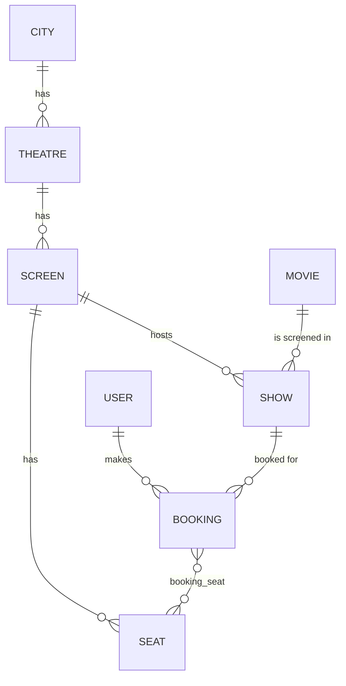

# 🎬 Movie Booking Backend

A RESTful backend for a movie ticket booking platform, built with **Spring Boot**, **Spring Data JPA** and **MySQL**. Users can browse movies by city, pick a theatre and show, select seats and book tickets.

> 📐 Architecture, data model and design decisions: see [SYSTEM_DESIGN.md](./SYSTEM_DESIGN.md)

---

## ✨ Features

- Browse **cities → theatres → screens → shows**
- Movie catalogue (title, language, duration, genre, etc.)
- Seat layout per screen, with seat selection for a show
- Create and view **bookings** (a booking holds one or more seats for a show)
- User management
- Layered architecture (Controller → Service → Repository) with JPA entities
- Sample SQL data for quick local testing

<!-- TODO: add/remove features to match what you actually implemented -->

## 🛠️ Tech Stack

| Layer | Technology |
|---|---|
| Language | Java (17+) |
| Framework | Spring Boot (Web, Data JPA) |
| ORM | Hibernate / JPA |
| Database | MySQL 8 |
| Build tool | Maven |
| Utilities | Lombok |

<!-- TODO: confirm Java version and Spring Boot version from pom.xml -->

## 📁 Project Structure

```
Movie-Booking-Backend-Project/
├── BMS-Backend/          # Spring Boot application
│   └── src/main/java/com/cfs/BMS/
│       ├── controller/   # REST controllers
│       ├── service/      # Business logic
│       ├── repository/   # Spring Data JPA repositories
│       ├── entity/       # JPA entities
│       └── ...
├── UI/                   # Simple frontend
└── README.md
```

<!-- TODO: adjust folder names to match your actual packages -->

## 🗄️ Data Model

Core entities: `User`, `City`, `Movie`, `Theatre`, `Screen`, `Seat`, `Show`, `Booking` (with a `booking_seat` join table).



## 🚀 Getting Started

### Prerequisites

- JDK 17 or newer
- Maven 3.8+
- MySQL 8 running locally

### 1. Clone the repository

```bash
git clone https://github.com/sRao2405/Movie-Booking-Backend-Project.git
cd Movie-Booking-Backend-Project/BMS-Backend
```

### 2. Create the database

```sql
CREATE DATABASE BMS;
```

### 3. Configure the application

Edit `src/main/resources/application.properties`:

```properties
spring.datasource.url=jdbc:mysql://localhost:3306/BMS
spring.datasource.username=YOUR_DB_USER
spring.datasource.password=YOUR_DB_PASSWORD
spring.jpa.hibernate.ddl-auto=update
spring.jpa.show-sql=true
```

> ⚠️ Don't commit real credentials. Use environment variables instead, e.g. `spring.datasource.password=${DB_PASSWORD}`.

### 4. (Optional) Load sample data

Run the provided sample SQL script against the `BMS` database to get cities, movies, theatres, screens, seats and shows to play with.

### 5. Run the app

```bash
./mvnw spring-boot:run
# or
mvn spring-boot:run
```

The API starts on `http://localhost:8080`.

## 📡 API Endpoints

<!-- TODO: replace with your real routes from the controllers -->

| Method | Endpoint | Description |
|---|---|---|
| GET | `/cities` | List all cities |
| GET | `/movies` | List all movies |
| GET | `/theatres?cityId={id}` | Theatres in a city |
| GET | `/shows?movieId={id}&cityId={id}` | Shows for a movie in a city |
| GET | `/shows/{showId}/seats` | Seat availability for a show |
| POST | `/bookings` | Create a booking |
| GET | `/bookings/{id}` | Get booking details |
| GET | `/users/{id}/bookings` | Booking history of a user |

### Sample request: create a booking

```http
POST /bookings
Content-Type: application/json

{
  "userId": 1,
  "showId": 10,
  "seatIds": [101, 102]
}
```

## 🧪 Testing

```bash
mvn test
```

## 👤 Author

**Sahil Rao** · [GitHub](https://github.com/sRao2405)
