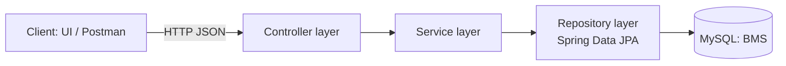
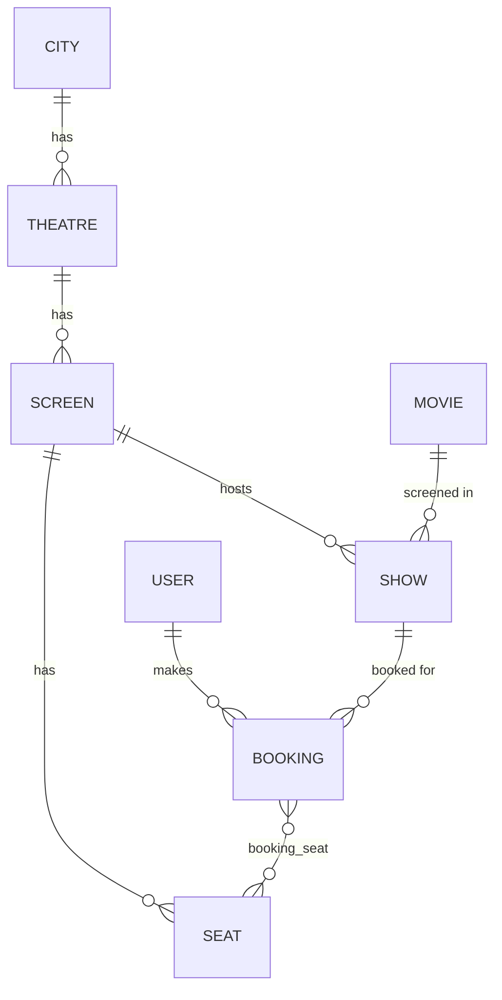
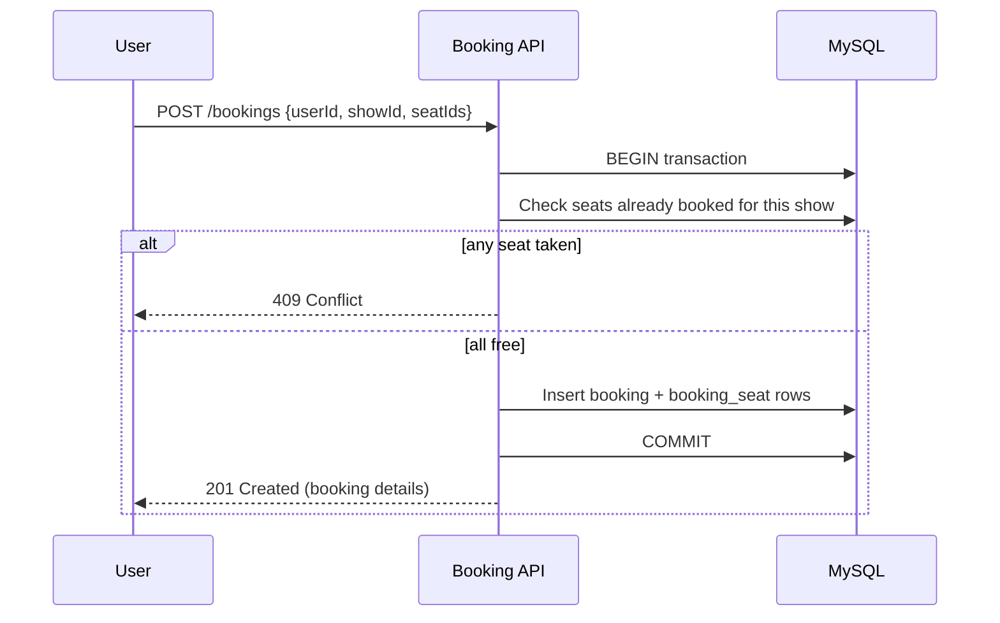

# System Design: Movie Booking Backend
 
## 1. Goals
 
- Let users discover movies and shows in their city.
- Let users select seats for a show and book them.
- Keep the data consistent: **one seat must never be sold twice for the same show**.
**Scope:** a single Spring Boot service with one MySQL database (a monolith). Payments, notifications and auth are future work.
 
## 2. High-Level Architecture
 

 
| Layer | Responsibility |
|---|---|
| Controller | Maps HTTP routes to service calls, handles request/response |
| Service | Business rules: availability checks, creating bookings, transactions |
| Repository | Data access through Spring Data JPA / Hibernate |
| Entity | JPA mappings to tables |
 
## 3. Data Model
 

 
**Hierarchy:** City → Theatre → Screen → Seat. A **Show** ties a Movie to a Screen at a start time. A **Booking** ties a User to a Show and a set of Seats.
 
## 4. Key Flows
 
### 4.1 Browse and select seats
 
1. Client picks a city, then a movie.
2. Backend returns the shows for that movie in that city, grouped by theatre.
3. Client picks a show. Backend returns all seats of the show's screen, marking which are already booked for that show.
### 4.2 Book tickets
 

 
The availability check and the insert must happen inside **one transaction** (`@Transactional`).
 
## 5. Known Design Gap: Double Booking
 
This is the most important thing to fix, and the best talking point in an interview.
 
**The problem.** If `Seat` belongs to a `Screen` (a physical seat) and `booking_seat` only links `booking_id` to `seat_id`, the database cannot say "this seat is taken *for this show*". Uniqueness of a seat per show has to be enforced in application code. Two users clicking the same seat at the same moment can both pass the "is it free?" check and both be booked (a race condition).
 
**The fix: add a `ShowSeat` table.**
 
| Column | Notes |
|---|---|
| `id` | PK |
| `show_id` | FK to Show |
| `seat_id` | FK to Seat |
| `status` | `AVAILABLE`, `HELD`, `BOOKED` |
| `booking_id` | nullable FK |
| `version` | for optimistic locking |
 
Add `UNIQUE (show_id, seat_id)` and generate one row per seat when a show is created. Then booking becomes "flip these rows from AVAILABLE to BOOKED", and the database guarantees correctness.
 
**Concurrency options**
 
| Approach | How | Trade-off |
|---|---|---|
| Optimistic locking | `@Version` on `ShowSeat`; a conflicting update throws `OptimisticLockException`, return 409 | Cheap, great when conflicts are rare |
| Pessimistic locking | `@Lock(PESSIMISTIC_WRITE)` on the seat query (`SELECT ... FOR UPDATE`) | Safest, but holds row locks and can reduce throughput |
| Unique constraint | Let the DB reject the duplicate insert | Simple last line of defence, use alongside the others |
 
**Proving it works:** write a test where 50 threads try to book the same seat and assert that exactly one succeeds.
 
## 6. Planned Improvements
 
| Area | Improvement |
|---|---|
| Seat hold | Temporarily hold seats (`HELD`) for about 5 minutes using Redis TTL or an `expires_at` column, released by a scheduled job if payment doesn't finish |
| Auth | Spring Security with JWT; roles USER and ADMIN (admins manage movies, theatres, shows) |
| Payments | Razorpay test mode; booking states `PENDING → CONFIRMED / FAILED / CANCELLED` |
| API quality | DTOs instead of exposing entities, `@Valid` validation, `@ControllerAdvice` for errors, pagination |
| Performance | Index `show(movie_id, start_time)`, `theatre(city_id)`, `show_seat(show_id, status)`; cache movie and city lists |
| Docs and ops | Swagger/OpenAPI, Dockerfile and Docker Compose, Actuator health checks |
 
## 7. Scaling Notes (interview talking points)
 
- **Stateless service:** with JWT and no server-side session, you can run several instances behind a load balancer.
- **Read-heavy catalogue:** movie, city and theatre listings rarely change, so cache them (Redis) and keep MySQL for bookings.
- **Hot shows:** a popular release creates heavy contention on a few rows. Seat holds, short transactions and a queue in front of booking help.
- **Read replicas:** send browse queries to replicas and bookings to the primary.
- **Later:** split into catalogue, booking and payment services, with events (Kafka/RabbitMQ) for confirmation emails.
## 8. Tech Decisions
 
| Decision | Why |
|---|---|
| Spring Boot + JPA | Fast development, strong ecosystem, widely used in industry |
| MySQL | Relational data with transactions fits booking consistency |
| Monolith first | Simpler to build, test and deploy; split only when needed |
| Layered architecture | Clear separation, easy to test each layer |
 
